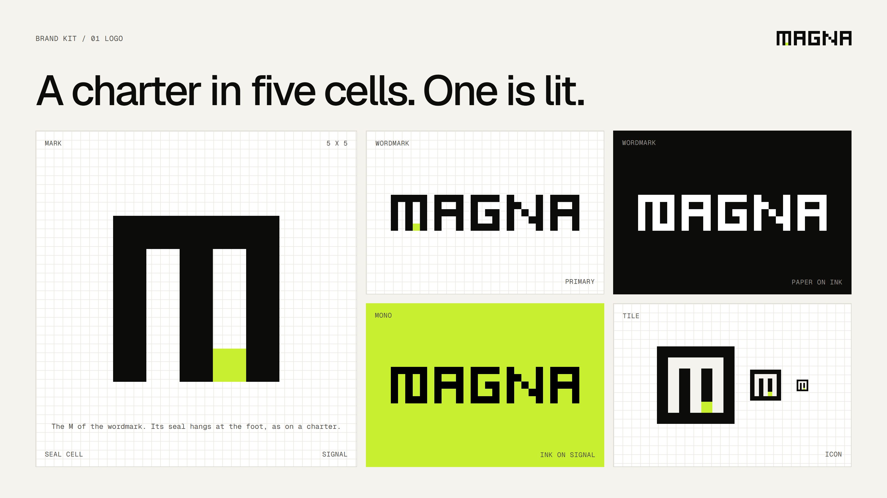
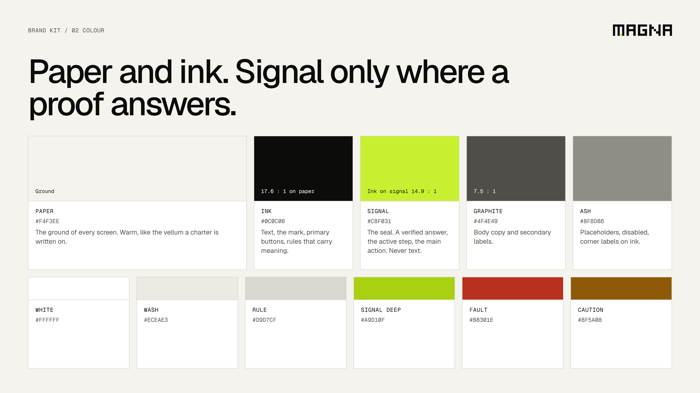
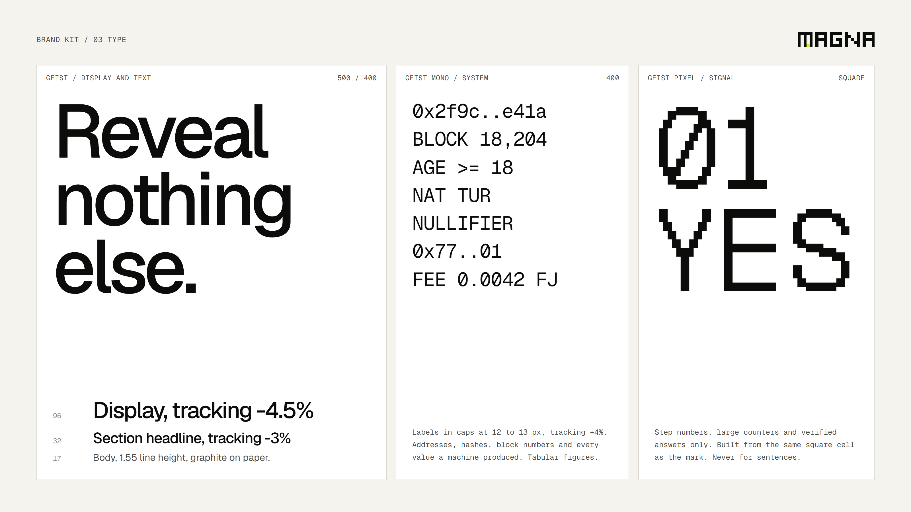
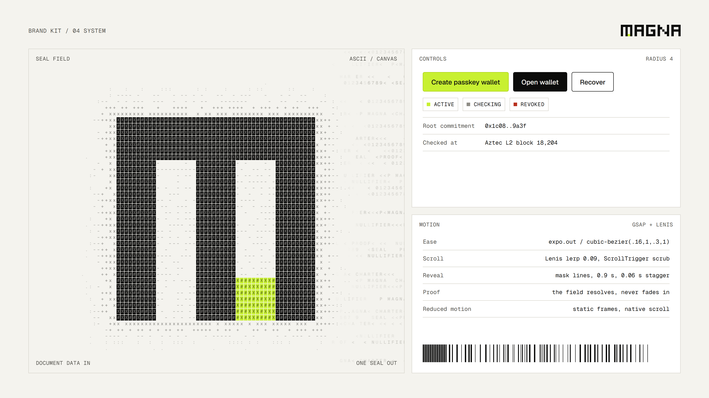
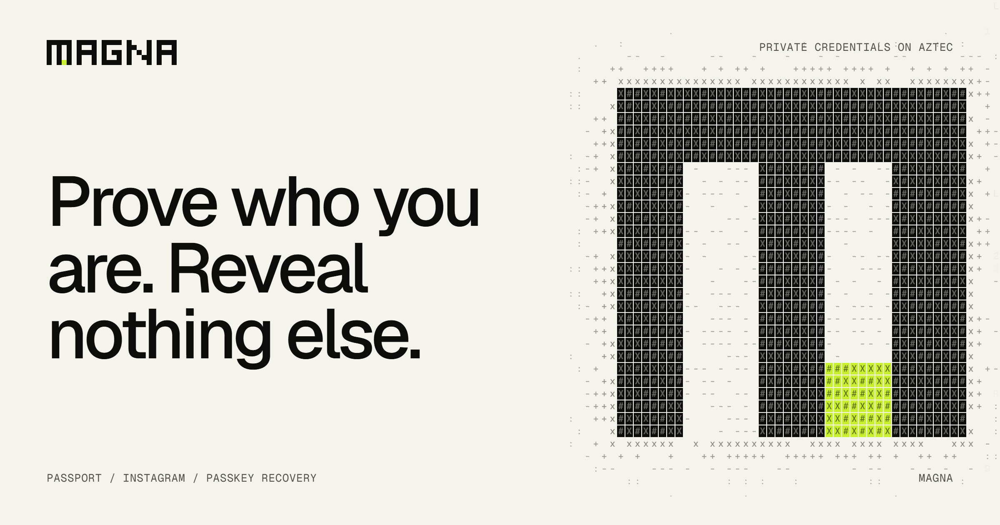

# Magna brand kit

Everything here is generated. The logo is data in `logo.mjs`; the seal field is `source/ascii-field.js`.
`render.mjs` writes the SVGs, the kit sheets, the logo PNGs and the files the apps use
(`apps/*/src/brand/logo-data.ts`, `apps/*/src/brand/ascii-field.js`, `apps/*/public/favicon.svg`), so the
mark and the field cannot drift between the brand kit and the product.

```sh
cd brand
npm install          # once: Playwright for rendering
node render.mjs      # everything
node render.mjs og   # only outputs whose name contains "og"
node render.mjs --serve   # http://127.0.0.1:4600/brand/source/ to edit sheets live
```







## The idea

Magna takes its name from the Magna Carta of 1215, the charter that first wrote down what power could not demand
of a person. Magna does the same for identity online: an app may ask for proof, never for the document.

A charter was closed with a seal. The seal proved who sent it without opening the letter. That is the whole
product: a passport, an Instagram account, a passkey go in; one sealed answer comes out.

**Line:** Prove who you are. Reveal nothing else.

## Logo

The mark is an arched M on a 5 x 5 grid. Its two slots are the folds of a sealed letter. One cell at the foot of
the right slot is lit in signal: on old charters the seal hangs at the bottom. It is the only thing the mark lets
out, the single bit an app receives. The wordmark MAGNA is built from the same cell, and its M is the mark
itself, seal included, so the logo never repeats the M.

| File | Use |
|---|---|
| `logo/wordmark.svg` | **Primary.** Headers, footers, social cards, kit sheets. |
| `logo/mark.svg` | The M alone. Small spaces, loaders, where the name is already on screen. |
| `logo/mark-mono.svg`, `logo/wordmark-mono.svg` | One colour (`currentColor`): ink on paper or signal, paper on ink. |
| `logo/tile.svg` | Paper M with the lit seal on an ink square. Favicon, app icon, avatars. |
| `kit/logo/*.png` | 1024 px wide, transparent, whole-cell scale. |

Rules:
- Clear space: one cell on every side.
- Minimum size: mark 15 px (3 px a cell), wordmark 96 px wide. Below that use the tile.
- Scale by whole cells so every edge stays sharp. `shape-rendering: crispEdges` is set in every SVG.
- The seal cell is always signal in colour versions and disappears in mono versions. Never move or recolour it.
- Never stretch, rotate, outline, round, shadow or animate the cells apart. One logo per surface.

## Colour

Paper and ink. Signal only where a proof answers.

| Token | Hex | Role |
|---|---|---|
| Paper | `#F4F3EE` | The ground of every screen. |
| White | `#FFFFFF` | Raised surfaces: panels, cards, inputs. |
| Wash | `#ECEAE3` | Quiet fills, graph-paper lines, hover. |
| Rule | `#D9D7CF` | Hairlines between rows and around panels. |
| Ink | `#0C0C0B` | Text, the mark, primary buttons. 17.6 : 1 on paper. |
| Graphite | `#4F4E49` | Body copy and secondary labels. 7.5 : 1 on paper. |
| Ash | `#8F8D86` | Placeholders, disabled, decorative glyphs. 3.0 : 1: never for text people must read. |
| Signal | `#C8F031` | **The seal.** Verified answers, the active step, the main action. A fill, never text (ink on signal is 14.9 : 1). |
| Signal deep | `#A9D10F` | Border and pressed state of signal fills. |
| Fault | `#B8301E` | Errors, revoked states. 5.4 : 1 on paper. |
| Caution | `#8F5A08` | Pending, counterfactual, blocked. 5.2 : 1 on paper. |

Light only. There is no dark theme: ink panels appear as single surfaces inside the light page, never as a mode.

## Type

| Role | Face | Setting |
|---|---|---|
| Display, headlines, body | Geist | 500 for display with -4.5% tracking, 500 for headlines with -3%, 400 body at 1.55 line height. Never bold. |
| System | Geist Mono | Caps labels at 12 to 13 px, +4% tracking. Addresses, hashes, block numbers, every machine value. Tabular figures. |
| Signal | Geist Pixel Square | Step numbers, big counters, verified answers. Same square cell as the mark. Never sentences. |

Fonts are self-hosted from `fonts/` (SIL Open Font License, `fonts/OFL.txt`) and copied into each app's
`public/fonts/`.

## System

- **Graph paper:** diagrams and hero panels sit on a 16 px grid in wash on white.
- **Corner labels:** panels are framed by four small mono labels (what it is, its unit, its input, its output),
  never by decorative lines.
- **Barcodes:** proof bits. Dense at the start, sparse after; generated, not drawn.
- **Seal field:** the ASCII canvas. Rows of passport MRZ data drift in ash; a proof front resolves them into the
  seal in ink tiles with one signal cell. It resolves, it never fades in.
- **Radius:** 4 px on controls and panels. Square cells everywhere else.
- **Controls:** primary is ink, the one main action per screen is signal, secondary is an ink outline.

## Motion

- GSAP with ScrollTrigger, Lenis for smooth scroll (lerp 0.09). The GSAP ticker drives Lenis.
- Ease: `expo.out` (`cubic-bezier(.16, 1, .3, 1)`).
- Headlines reveal by masked lines, 0.9 s, 0.06 s stagger. Numbers count in Geist Pixel.
- The landing timeline is pinned and scrubbed: the reader travels through the five steps of a credential.
- `prefers-reduced-motion`: no smoothing, no scrub, static final frames.

## Voice

Plain, exact, calm. Say what the system proves and what it never sees. Short sentences, real numbers, no hype.

## Never

Em dashes, dot separators between words, accent underlines or stripes, gradients, glows, glassmorphism, drop
shadows on text, bold headlines, emoji, blinking or pulsing dots, a dark mode, signal as text colour, more than one
signal action per screen.
